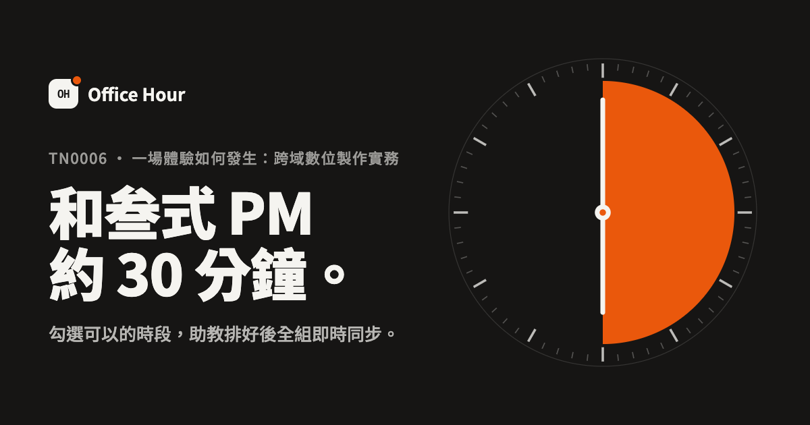
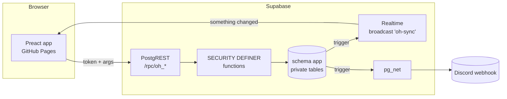

# Office Hour

**和叁式 PM 約 30 分鐘。**
TN0006「一場體驗如何發生：跨域數位製作實務」的 Office Hour 預約平台。學生勾選可以的時段，助教一鍵排程，全組、老師、助教的畫面即時同步。

- 正式網站：<https://g904338.github.io/tnda-office-hour/>
- 示範模式（不需代碼，三種角色都能試）：<https://g904338.github.io/tnda-office-hour/#/demo>



---

## 三種角色

| | 學生 | 助教 | 老師（叁式 PM） |
|---|---|---|---|
| 怎麼進來 | 點小組的邀請連結，輸入名字 | 助教代碼 | 個人專屬連結 |
| 看得到 | 自己這組的需求、排定的時間 | 全部 | 自己的場次與準備資料、兩週內全部場次 |
| 能做什麼 | 勾選時段、寫題目與進度、取消、加入行事曆 | 排程、發布、管理小組／老師／時段／週次／規則、匯出 | 加入行事曆（其他事助教處理） |

**老師只看必要的資訊。** 打開連結就是「下一場什麼時候、哪一組、要聊什麼、資料在哪」，不需要任何設定或操作。

## 一學期的用法（助教）

1. 用助教代碼登入。
2. **小組與邀請**：把每組的邀請連結貼到該組 Discord，或在課堂上「投影邀請 QR」讓同學掃描。
3. **老師**：把每位老師的專屬連結私訊給他們。
4. **時段與週次**：確認老師的開放時段、國定假日、哪幾週開放預約。
5. 每週：**排程** → 按「智慧排程」產生草稿 → 檢查、拖曳調整 → 「發布」。
   發布後學生和老師的畫面會立刻更新；有連結 Discord 的組別會自動收到通知，其他組可以一鍵複製通知文字。
6. 想讓通知自動進 Discord：在小組卡片按「連結頻道」，貼上該頻道的 Webhook 網址。

規則（每週／每天上限、預約截止、可取消時間、公告）都在 **設定** 裡調整，改動立即生效。

## 設計

- **紙、墨、一個訊號色。** 版面只靠字級與留白建立層次；橘色只出現在「你選的」和「正在發生的」東西上。
- **一個畫面一件事。** 學生首頁先回答「下一次是什麼時候」，再談預約；老師首頁只有行程；助教的排程板把需求、空檔、草稿放在同一張表上。
- **即時、而且說得出發生了什麼。** 組員改了需求、助教排好時間、有人取消，畫面會更新並跳出一行說明，不需要重新整理。
- **手機優先。** 學生大多用手機：格子 44px 以上、可點可拖曳、無水平捲動；助教在手機上一次看一天。
- **無障礙。** 所有文字對比 ≥ 4.5:1（WCAG AA）、完整鍵盤操作、表單錯誤與說明以 `aria-describedby` 連結、支援減少動態效果與深色模式。

## 架構



- **後端就是一組 SQL 函式。** 所有資料表都在不對外開放的 `app` schema；瀏覽器只能呼叫 `public.oh_*` 函式，每個函式先驗證身份，再套用預約規則（截止日、每週／每日上限、老師不重複、組員同時編輯的版本衝突）。規則只寫在資料庫一處，任何客戶端都繞不過。
- **即時同步。** 每次寫入都會在 `oh-sync` 頻道廣播「哪張表變了」，只有表名，不含任何資料；客戶端收到後透過 API 重新取得自己有權看的資料。斷線時還有切回分頁、恢復網路、每分鐘輪詢三層保險。
- **示範模式跑的是同一套 SQL。** 用 [PGlite](https://pglite.dev)（編譯成 WebAssembly 的 Postgres）在瀏覽器裡建立完整資料庫，執行與正式環境完全相同的 migration。引擎從 jsDelivr 下載（約 2 秒），並用建置時記錄的 SHA-256 驗證；失敗時改用網站自帶的備份。
- **智慧排程是最大流問題。** `來源 → 小組 → 小組·當天 → 時段 → 老師容量`。第一階段讓每組最多一場、依「本學期次數少者優先、先送出者優先」增廣，得到能被服務的最多組數；第二階段再幫想約一小時的組補第二場。最後為每個時段分配老師，優先延續這組上次見過的 PM。

## 安全

- 邀請代碼由資料庫以 CSPRNG 產生（8／10／12 碼，排除易混淆字元），可隨時更換並一併登出舊裝置。
- 登入後裝置只保存一組隨機憑證（64 個十六進位字元）；資料庫只存它的 SHA-256。180 天未使用自動失效。
- 錯誤代碼猜測有 IP 節流（10 分鐘 20 次）。
- 資料表全部啟用 RLS 且沒有任何 policy，`anon` 角色只有 `oh_*` 函式的執行權；GraphQL 不暴露任何資料表（`npm run db:test-cloud` 會實際驗證）。
- 正式版有 Content-Security-Policy；使用者輸入一律以文字呈現，連結只接受 http(s)；CSV 匯出防公式注入；Discord 訊息關閉 @mention。
- Supabase 的帳號註冊已關閉（這個系統不使用 Supabase Auth）。

## 開發

```bash
npm install
npm run dev          # http://localhost:5173（沒有 .env.local 時只能用示範模式）
npm test             # 資料庫 API、排程演算法、Discord 通知：52 項
npm run build && npx vite preview --port 4173
npm run e2e -- http://localhost:4173/   # 真實瀏覽器跑三種角色（示範模式）
```

本機完整雲端堆疊（需要 Docker／Colima）：

```bash
supabase start
npm run db:reset-local                 # 固定測試代碼 LOCALADMIN01、LOCALG01…
npm run e2e:cloud -- http://localhost:5173/ LOCALG02 LOCALADMIN01
```

### 資料庫變更

在 `supabase/migrations/` 新增一個檔案（不要修改已部署的檔案），然後：

```bash
npm test
supabase db push
```

### 部署

推到 `main` 後，GitHub Actions 會依序執行型別檢查、單元與資料庫測試、正式建置、真實瀏覽器端對端測試，全部通過才部署到 GitHub Pages。另有每日排程呼叫一次 API，避免 Supabase 免費方案因閒置而暫停。

## 專案結構

```
supabase/migrations/   資料表、API 函式、Discord 通知、登入期限
supabase/seed.sql      課程初始資料（小組、老師、開放時段、W7–W18）
src/api/               雲端（Supabase）與示範（PGlite）兩種引擎，同一個介面
src/views/             student / teacher / admin / Welcome
src/lib/scheduler.ts   智慧排程（最大流）
tests/                 Vitest：資料庫規則、排程、示範資料、Discord
scripts/               端對端測試、雲端安全檢查、PGlite 資產準備
```

## 三分鐘展示腳本

1. **開場（20 秒）**：打開 `#/demo`。「每學期助教要和七組、三位 PM 來回喬時間，訊息散在 Discord 各處。這個平台把它變成一個畫面。」
2. **學生（60 秒）**：切到「學生」。首頁直接告訴你下一次是什麼時候、還有幾小時。點一個可預約的週次 →「開始預約」→ 按住滑鼠拖曳勾選多格 → 寫題目 →「送出」。「整組共用一份需求；兩個人同時改，系統會攔下衝突，不會互相覆蓋。」
3. **助教（60 秒）**：切到「助教」。排程板上，每格標出幾組想要、哪位 PM 有空。按「智慧排程」：「這是一個最大流問題——先確保最多組能排到、優先照顧討論次數少的組，再幫想約一小時的組補第二場，最後盡量延續上次的 PM。」→「直接發布」。
4. **老師（20 秒）**：切到「老師」。「PM 不需要學任何東西：打開連結就是下一場、哪一組、要聊什麼、雲端資料夾。」
5. **收尾（20 秒）**：「示範模式跑的是一個完整的 Postgres，在你的瀏覽器裡，執行與正式環境同一份 SQL。正式環境在 Supabase，所有規則寫在資料庫裡，任何人都繞不過；每個變動即時推送到每個人的畫面，也會自動通知 Discord。」
