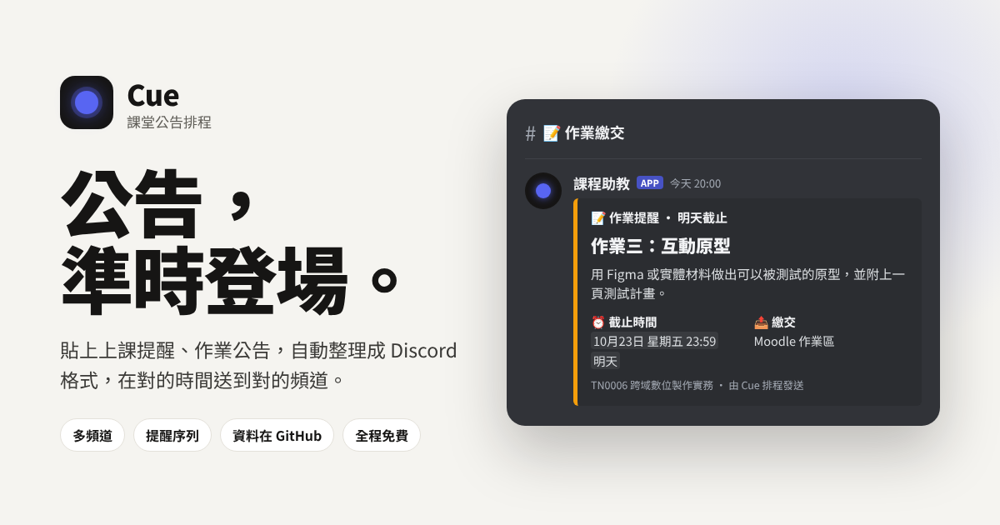
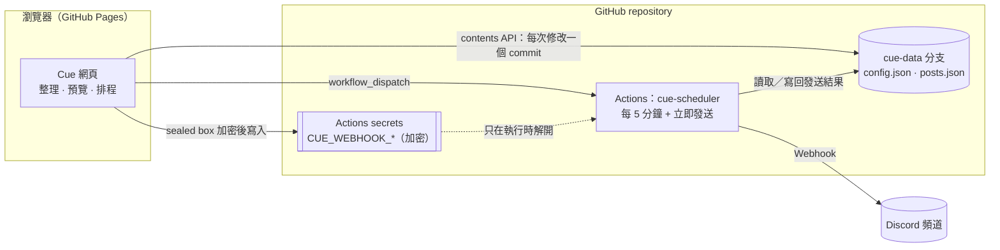

# Cue · 課堂公告排程

**公告，準時登場。**
把上課提醒、作業公告整段貼進來，Cue 會整理成 Discord 的格式，在你指定的時間送到對的頻道。資料存在這個 GitHub repository，排程交給 GitHub Actions，全程免費、沒有伺服器。

- 網址：<https://g904338.github.io/tnda-office-hour/cue/>
- 示範模式（不用任何設定，直接試）：<https://g904338.github.io/tnda-office-hour/cue/#/demo>



> 名字的由來：劇場裡的 cue 是「該你上場了」的提示。這門課談的是體驗如何發生，Cue 負責讓每一則公告在對的時刻登場。

---

## 上線三步驟

### 1. 把程式碼合併到 `main`

Cue 的程式碼在分支 `claude/compassionate-maxwell-jj1050`。打開
<https://github.com/g904338/tnda-office-hour/compare/main...claude/compassionate-maxwell-jj1050?expand=1>
建立 Pull Request 並合併。合併後 GitHub Actions 會跑完全部測試，然後把網站部署到 GitHub Pages（Office Hour 不受影響，Cue 在 `/cue/`）。同時，雲端排程器（`.github/workflows/cue-scheduler.yml`）也開始每 5 分鐘執行一次。

### 2. 連接 GitHub

1. 打開 <https://g904338.github.io/tnda-office-hour/cue/>，按「連接 GitHub 正式使用」。
2. 按「在 GitHub 建立權杖」。GitHub 會打開一張權限已經勾好的表單（Contents、Actions、Secrets 讀寫）。
   在 **Repository access** 選「Only select repositories」→ 選 `tnda-office-hour`，然後按 **Generate token**。
3. 把 `github_pat_…` 貼回 Cue，按「連接」，再按「建立資料分支」。

Cue 會新增一個沒有歷史的分支 `cue-data`，裡面只有 `config.json`、`posts.json` 和一份說明。不會動到任何其他分支。

> 權杖只存在你的瀏覽器裡。要在手機上用：**設定 → 帶到手機**，用手機掃 QR code 就連好了。

### 3. 新增 Discord 頻道

每個要發文的頻道做一次（約 30 秒）：

1. Discord：對頻道按右鍵 → **編輯頻道** → **整合** → **Webhook** → **新 Webhook** → **複製 Webhook 網址**。
2. Cue：**頻道 → 新增頻道**，取個名字、選圖示，貼上 Webhook 網址，按「新增頻道」。
3. 按「傳送測試」。大約 30 秒後 Discord 頻道會收到一則測試訊息，Cue 的頻道卡片會變成「已連線」。

> Webhook 網址不要貼在聊天室或任何文件裡。只要貼進 Cue：瀏覽器會立刻用 repository 的公開金鑰加密，存成 GitHub Actions secret（`CUE_WEBHOOK_…`），之後沒有任何地方看得到明文。

完成。之後的每一則公告都只要「貼上 → 確認 → 排程」。

---

## 日常使用

### 貼上，就整理好

在「撰寫公告」或首頁的快速貼上框貼入原文，Cue 會自動判斷：

| 會找出 | 例子 |
|---|---|
| 類型 | 上課、作業、考試、活動、教材、公告（第一行的字最有份量） |
| 時間 | `10/28 23:59`、`下週五晚上 12 點前`、`明天早上 10 點`、`第 8 週（二）`、`下午 2 點到 4 點` |
| 地點／繳交 | `地點：設計學院 B1`、`在創意基地`、`上傳到 Moodle 作業區`、Google Meet 連結 |
| 攜帶 | `請各組帶筆電和訪談紀錄` → 筆電、訪談紀錄 |
| 連結 | `簡報：https://…` 會用「簡報」當連結名稱；沒有名稱就用網站名稱 |
| 條列與注意事項 | `- ` 開頭的行、`注意：…`、`遲交扣分` 之類的句子 |
| 標註 | 原文裡的 `@everyone` / `@here` |

它也會提醒你常見的錯：**日期和星期幾對不上**（「10/21（二）」但 10/21 是星期三）、時間已經過了、深夜發送、超過 Discord 字數上限、頻道還沒設定 Webhook。

所有欄位都可以再改，右邊的預覽就是學生在 Discord 上會看到的樣子（深色／淺色都看得到）。

### 一則公告，一串提醒

有時間的公告可以同時排好幾次發送，每一次都會帶上剩多久的標籤：

- 作業（預設）：現在公告 → 截止前一天 20:00「明天截止」→ 截止前 3 小時「剩 3 小時」
- 上課：前一天 20:00「明天上課」→ 上課前 30 分鐘
- 考試：一週前、前一天

也可以加自訂時間。截止時間會用 Discord 的動態時間顯示：每個學生看到的是自己的時區，加上「3 天後」這樣的倒數。

### 每週重複

上課提醒打開「每週重複」，選結束日期，就會一次排好整學期。標題可以寫 `第 {週} 週上課提醒`，每一則會換成那一週的週次（在「設定 → 課程」填學期第一週的星期一）；`{n}` 是序號、`{日期}` 是日期。

### 發出去之後

- **發文紀錄**：所有貼文依日期排好，可以搜尋、依頻道或類型篩選、匯出 CSV。每一則都看得到在每個頻道的發送結果，也能直接在 Discord 開啟。
- **改內容**：已發送的貼文也能編輯，排程器會把 Discord 上的訊息改成新的版本。
- **撤回**：發錯了可以直接從 Discord 刪除，紀錄保留為「已撤回」。
- **失敗**：會出現在「需要處理」，並說明原因（例如 Webhook 被刪掉了）。修好之後按「重送失敗的頻道」，已經成功的頻道不會重複發送。GitHub 也會寄信通知你有發送失敗。
- **行事曆**：每一則公告排在發送的那一天，截止日與上課時間用虛線標出。把排程中的公告拖到另一天就能改日期。

---

## 運作方式



- **資料就是兩個 JSON 檔。** `cue-data` 分支沒有程式碼，只有資料；每一次修改都是一個有說明的 commit，所以分支的歷史就是完整的發文紀錄，也能用 GitHub 還原任何一個版本。
- **多台裝置同時改也不會互相覆蓋。** 每次寫入都帶著檔案的版本（sha），若別人剛好先寫入，Cue 會把同一個修改套用到最新版本再寫一次。網頁每 20 秒檢查一次更新（用 ETag，不消耗 API 額度）。
- **排程器要準時。** GitHub 的排程每 5 分鐘觸發一次，但可能晚幾分鐘開始；排程器會把「接下來 8 分鐘內」要發的公告等到那一分鐘才送出，所以通常誤差在 1 分鐘內。按「立即發送」會直接觸發一次。
- **不會重複發送。** 送出前會先在資料裡「認領」這則公告；就算執行到一半中斷，也不會在下一次重送，而是標成需要確認。
- **不會一次湧出一堆舊公告。** 排程器若停擺太久，超過門檻（預設 12 小時）的公告會標成「已錯過」，由你決定要不要補發。
- **示範模式跑的是同一套排程邏輯。** `scripts/cue/engine.mjs` 同時被雲端排程器和瀏覽器裡的模擬排程器使用。
- **整理不靠 AI。** 解析器是為台灣課堂公告寫的規則（`src/cue/core/parse.ts`），即時、離線、可預測，也不會編出原文沒有的內容。

## 安全與隱私

- **Webhook 網址不會出現在任何地方。** 在瀏覽器裡用 libsodium sealed box 加密後存成 GitHub Actions secret，只有排程器執行時能解開；資料分支、網頁、備份檔都沒有它。
- **權杖只存在使用者的瀏覽器**，建議只授權這一個 repository、設定到期日。裝置連結的權杖放在網址的 `#` 後面，不會送到任何伺服器，開啟後就從網址列移除。
- **這個 repository 是公開的，所以 `cue-data` 裡的公告內容也是公開的**（包含還沒發送的）。公告本來就是要給全班看的，但請不要把不該提早公開的資訊（例如考題）放進去。
- **沒有人會被意外標註。** 只有你選了 @everyone／@here／身分組時，訊息才會通知大家；原文裡打的 @everyone 不會生效。
- 網站有 Content-Security-Policy，只能連到 GitHub API；所有使用者輸入都以純文字呈現，預覽中的連結只接受 http(s)，CSV 匯出防公式注入。

## 費用：全部免費

| 服務 | 用途 | 方案 |
|---|---|---|
| GitHub Pages | 網站 | 公開 repo 免費 |
| GitHub Actions | 每 5 分鐘的排程器、測試、部署 | 公開 repo 不限分鐘數 |
| GitHub repository | 資料（cue-data 分支）與加密的 Webhook | 免費 |
| Discord Webhook | 發文 | 免費 |

## 限制與常見問題

- **GitHub 排程偶爾會晚。** GitHub 很忙的時候（尤其整點），排程可能晚十幾分鐘才開始；8 分鐘的等待窗口能吸收大部分延遲。需要分秒不差的公告請用「立即發送」。
- **60 天沒有活動的 repository，GitHub 會停用排程。** 停用時 Cue 的首頁和設定頁會顯示，按「啟用」即可恢復。
- **論壇（Forum）頻道**需要指定討論串，目前不支援；一般文字頻道與公告頻道都可以。
- **Discord 的限制**：一般訊息 2,000 字、卡片 6,000 字，Cue 會在送出前檢查；Webhook 的名稱不能包含 discord 或 clyde。
- **換學期**：在「設定 → 課程」改學期開始日。舊的貼文留著當紀錄；也可以先「匯出 JSON」備份。

## 開發

```bash
npm install
npm run dev                      # http://localhost:5173/cue/
npm test                         # 包含 Cue 的解析器、渲染、排程、加密、雲端排程器與 GitHub 同步
npm run build && npx vite preview --port 4173
npm run e2e:cue -- http://localhost:4173/cue/   # 真實瀏覽器走完所有流程 + 無障礙掃描
```

在本機試雲端排程器（不會真的發到 Discord）：

```bash
GITHUB_TOKEN=… GITHUB_REPOSITORY=g904338/tnda-office-hour CUE_DRY_RUN=1 node scripts/cue/scheduler.mjs
```

### 專案結構

```
cue/index.html                  Cue 的頁面（和 Office Hour 共用一次建置）
src/cue/core/                   純函式：時間、解析、Discord 渲染、Markdown 預覽、提醒規劃、資料操作
src/cue/data/                   GitHub 同步、示範模式、sealed box 加密、示範資料
src/cue/views/                  每一個畫面
scripts/cue/engine.mjs          排程器的狀態機（雲端與示範共用）
scripts/cue/scheduler.mjs       GitHub Actions 執行的排程器
.github/workflows/cue-scheduler.yml
tests/cue/                      Vitest 單元與整合測試
scripts/cue-e2e.mjs             Playwright 端對端測試 + axe 無障礙掃描
```

## 三分鐘展示腳本

1. **開場（20 秒）**：「助教每週要在 Discord 好幾個頻道發上課提醒、作業公告、截止前再催一次。訊息格式每次都不一樣，還常常忘記發。」打開 `/cue/`。
2. **現場試（40 秒）**：在首頁右邊的框裡隨便貼一段公告，或點「考試」範例。「它找出了時間、地點、要帶什麼，排成 Discord 卡片。寫錯星期幾它也會提醒你。」
3. **排程（50 秒）**：按「立即試用」→ 首頁快速貼上作業公告 →「整理」。指出右邊三個分頁：「一則公告自動變成三則：現在公告、截止前一晚提醒、最後三小時。每則都看得到學生會收到的樣子。」→「排程 3 則」。
4. **營運（40 秒）**：「需要處理」裡有一則失敗：「Webhook 被刪掉了，它說得出原因。」到頻道頁重貼 Webhook →「傳送測試」→ 回去「重送失敗的頻道」。再到行事曆把一則提醒拖到別天。
5. **收尾（30 秒）**：「沒有伺服器、全程免費。資料是 repository 裡的兩個 JSON 檔，每次修改都是 commit；Webhook 在瀏覽器裡就加密進 GitHub Secrets；發送交給 GitHub Actions，會等到那一分鐘才送出，也不會重複發送。」
